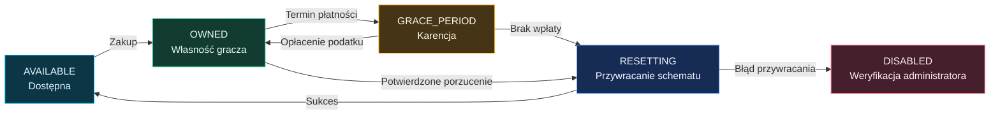

<p align="center">
  
</p>

<h1 align="center">riftPlots</h1>

<p align="center">
  <strong>Zbuduj miasto, w którym każda nieruchomość ma swoją historię.</strong><br>
  Działki miejskie, wynajem, podatki i licytacje dla serwerów Minecraft Paper.
</p>

<p align="center">
  
  
  
  
</p>

<p align="center">
  <a href="#szybki-start">Szybki start</a> ·
  <a href="https://github.com/tenfajnybartek/riftPlots/wiki">Wiki</a> ·
  <a href="docs/commands.md">Komendy i uprawnienia</a> ·
  <a href="docs/operations.md">Konfiguracja i obsługa</a> ·
  <a href="docs/architecture.md">Dla programistów</a> ·
  <a href="docs/review.md">Przegląd kodu</a>
</p>

---

## Miasto gotowe na graczy

**riftPlots** pozwala udostępniać graczom przygotowane budynki i lokale: kamienice przy rynku, mieszkania, sklepy czy hale przemysłowe. Administrator zaznacza przestrzeń w WorldEdit, zapisuje jej stan i ustala zasady korzystania. Gracze kupują nieruchomości, wynajmują je, opłacają podatki i zawierają transakcje między sobą.

Każda działka ma **trójwymiarowe granice**. Możesz wydzielać lokale na różnych piętrach, o ile ich obszary i regiony WorldGuard nie nachodzą na siebie. Plugin zarządza zaznaczonymi obiektami; nie generuje świata ani siatki parcel.

| Dla graczy | Dla administracji |
| :--- | :--- |
| Zakup przez komendę, GUI lub tabliczkę | Tworzenie działek z zaznaczenia WorldEdit |
| Wynajem z kaucją i świadomym wyborem odnowienia | Typy i dzielnice z dziedziczeniem oraz nadpisaniami |
| Oferty sprzedaży między graczami | Sześć modeli podatku i okres karencji |
| Aukcje z historią, kup teraz i opcjonalnym depozytem | Schematy `.schem`, podgląd resetu i przywracanie bloków partiami |
| Punkt domowy i powrót na działkę | Budżet miasta, historia transakcji i logi audytu |
| Stronicowane GUI, edytor dostępu i granice 3D | Dziennik rozliczeń, trwałe zwroty i diagnostyka |

Wdrożenie **P1–P2** obejmuje też trwałe wiadomości i oferty transferu, kolejkę migracji, wersjonowanie danych, CI oraz narzędzie kopii zapasowych. [Nowe komendy i zasady aktualizacji →](docs/wiki/Nowosci-P1-P2.md)

<p align="center">
  
</p>

## Wymagania

Wersje poniżej wynikają z konfiguracji repozytorium. Zgodność konkretnego zestawu pluginów należy sprawdzić na serwerze testowym.

| Element | Wymaganie projektu |
| :--- | :--- |
| Serwer | **Paper 26.3** — docelowe API z `plugin.yml` |
| Java | **JDK 25** do budowania; Java 25 do uruchomienia |
| Ochrona regionów | **WorldGuard**; zależność kompilacyjna `7.0.12` |
| Zaznaczenia i schematy | **WorldEdit**; zależność kompilacyjna `7.3.10` |
| Ekonomia | **Vault** i zarejestrowany provider ekonomii |
| Baza danych | Domyślnie **SQLite**; zewnętrzna baza jest opcjonalna |

WorldEdit, WorldGuard i Vault instalujesz osobno. Sterowniki baz danych i HikariCP są dołączane do wynikowego JAR-a. Bez providera ekonomii plugin przerywa uruchamianie.

Próbę integracyjną wykonano na **Paper 26.3 build 246, WorldEdit 7.4.6, WorldGuard 7.0.21 i Vault 1.7.3**, z kontrolowanym providerem testowym ekonomii. API Paper jest przypięte do `26.3.build.246-stable`.

## Szybki start

### 1. Zbuduj i zainstaluj

W katalogu repozytorium, z dostępnym JDK 25:

```powershell
# Windows
.\gradlew.bat build
```

```bash
# Linux / macOS
./gradlew build
```

Umieść **`build/libs/riftPlots-1.0.0.jar`** w katalogu `plugins/` razem z wymaganymi integracjami. Uruchom serwer i sprawdź konsolę. Konfiguracja pojawi się w `plugins/riftPlots/`; domyślny magazyn to SQLite.

### 2. Przygotuj pierwszą nieruchomość

Zbuduj lokal, wybierz zaznaczenie prostopadłościenne WorldEdit (`//sel cuboid`, `//wand`) i zaznacz dwa przeciwległe narożniki. Uwzględnij podłogę, sufit oraz wszystkie bloki, które mają podlegać ochronie i resetowi.

```text
/plots admin create rynek_1 Kamienica przy rynku
/plots admin type set rynek_1 COMMERCIAL
/plots admin district set rynek_1 centrum
/plots admin setprice rynek_1 45000
/plots admin settax rynek_1 3000
/plots admin settaxmode rynek_1 FIXED
/plots admin setperiod rynek_1 7
```

Przy tworzeniu zapisywany jest schemat budynku i powstaje region WorldGuard. Identyfikator ma 2–32 znaki: litery, cyfry, `_` lub `-`.

> **Ceny i typy:** nowe działki dziedziczą stawki typu. Cena dziedziczona uwzględnia `price-multiplier` dzielnicy; `setprice` ustala końcową cenę ręczną. Starsze rekordy zachowują dotychczasowe parametry. `/plots admin type apply-defaults <id>` pokazuje zmiany przed ich potwierdzeniem. [Szczegóły konfiguracji →](docs/operations.md#typy-i-dzielnice)

### 3. Dodaj tabliczkę

Spójrz na tabliczkę w odległości do pięciu bloków:

```text
/plots admin sign rynek_1 FOR_SALE
```

**PPM** służy do zakupu; **LPM** wyświetla informacje. Typ `RENEW` służy do opłacania podatku, a `STATUS` pokazuje informacje o działce. Aktywna aukcja lub oferta najmu blokuje zwykły zakup.

## Życie w mieście

### Kup, zamieszkaj, opłać

```text
/plots
/plots buy rynek_1
/plots sethome rynek_1
/plots home rynek_1
/plots trust Przyjaciel rynek_1
/plots pay rynek_1 2
```

`/plots` otwiera stronicowany rynek z zakładkami **Moje**, **Dostępne**, **Wynajem** i **Aukcje**, sortowaniem oraz filtrami typu i dzielnicy. `/plots border rynek_1` pokazuje tymczasowy obrys 3D. Domyślna teleportacja kosztuje **50 jednostek waluty**, z czasem odnowienia **10 sekund**.

`trust` daje dostęp do interakcji, drzwi, pojemników i teleportacji. **Nie nadaje domyślnie prawa budowania ani niszczenia.** Właściciel może edytować rolę i prawa w panelu członków. Najemca otrzymuje dodatkowo prawa do budowania i niszczenia na czas umowy. Starsze zapisane zestawy praw pozostają zachowane.

### Wynajmij lokal

```text
/plots admin rent offer apartament_4 250 DAY 500
/plots rent apartament_4 7
/plots rent info apartament_4
/plots rent autorenew apartament_4 on
```

W tym przykładzie pierwszy koszt to **2 250**: siedem dni czynszu po 250 i kaucja 500. Auto-odnowienie jest domyślnie **wyłączone**; ostatnia komenda włącza je świadomie. Jednostki: `HOUR`, `DAY`, `WEEK`, `MONTH`; miesiąc domyślnie oznacza **30 dni** (`rental-period-seconds.MONTH`). Najemca może zakończyć umowę przez `/plots rent cancel apartament_4 confirm`; opłacony czynsz nie jest zwracany, a kaucja trafia do rozliczenia niezależnego od dostępu. Właściciel może wystawić swój lokal z osobnym uprawnieniem `riftplots.rent.offer`.

### Sprzedaj innemu graczowi

```text
/plots transfer Kupujacy 60000 rynek_1
/plots accept <id_oferty>
/plots deny <id_oferty>
```

Domyślnie oferta trwa **300 sekund**, a miasto otrzymuje **5% prowizji** z ceny sprzedaży. Bezpłatne przekazanie wymaga ceny `0`. Kupujący musi być online podczas tworzenia oferty. Działka nie może być w stanie zaległości podatkowej, najmu ani aukcji.

### Weź udział w aukcji

```text
/plots admin auction start willa_1 50000 2500 30 150000
/plots auction list
/plots auction bid willa_1 52500
/plots auction history willa_1
/plots auction buy willa_1 confirm
```

Parametry to: cena wywoławcza, minimalne przebicie, czas w minutach i opcjonalna cena „kup teraz”. Oferta w końcowym oknie domyślnych **120 sekund** zapewnia kolejne 120 sekund na odpowiedź. Osiągnięcie ceny „kup teraz” uruchamia rozliczenie od razu.

Domyślnie środki są pobierane **przy rozliczeniu**. Opcjonalne `auction.escrow-enabled: true` rezerwuje je podczas licytacji w nowych aukcjach; przebita oferta otrzymuje trwały zwrot, a zwycięzca nie płaci drugi raz. Historia przebić przetrwa restart. Administrator może anulować aukcję przez `/plots admin auction cancel willa_1 confirm <powód>`.

## Podatki i powrót nieruchomości do miasta



Domyślnie nowa działka kosztuje **25 000**, a podatek bazowy wynosi **1 500 co 7 dni**. Karencja trwa **6 godzin**, a terminy są sprawdzane co **60 sekund**. Gracz może opłacić do czterech dodatkowych okresów z góry.

Dostępne modele: `FIXED`, `PER_BLOCK`, `PER_CHUNK`, `SIZE_TIERS`, `MULTIPLIER`, `CUSTOM`. [Wzory, progi i przykłady →](docs/operations.md#podatki)

Przywracanie obejmuje bloki i dane bloków zapisane w schemacie, z wyłączonym kopiowaniem encji. Domyślnie wklejane jest do **2 500 bloków na porcję**, co **1 tick**. Przerwany reset jest wznawiany po uruchomieniu pluginu. Brak schematu nie jest traktowany jako udany reset — działka zostaje wyłączona do weryfikacji.

`/plots admin health` wyświetla diagnostykę bez zmiany danych. `admin reset <id>` i `admin restore <id>` pokazują podgląd; wykonanie wymaga `confirm`. Odczyt i wymiary schematu są sprawdzane przed odebraniem własności.

## Rozliczenia i powiadomienia

Zakupy, podatki, najem, transfery, aukcje i zwroty mają trwałe ID operacji. `/plots history [id|all] [strona]` pokazuje historię oraz stan zwrotów; historia nieruchomości jest domyślnie prywatna. Wiadomości offline przetrwają restart i są dostępne przez `/plots notifications [strona]`.

Niepewna odpowiedź Vault pozostawia operację do sprawdzenia przez `/plots admin transactions pending` i `inspect <id>`. Plugin nie powtarza automatycznie niepewnej wypłaty; administrator uzgadnia ją po sprawdzeniu sald i danych. [Procedura odzyskiwania →](docs/wiki/Nowosci-P1-P2.md#rozliczenia-po-awarii)

## Konfiguracja i dane

| Plik w `plugins/riftPlots/` | Zawartość |
| :--- | :--- |
| [`config.yml`](src/main/resources/config.yml) | Ekonomia, terminy, ochrona, reset, teleportacja i format tabliczek |
| [`storage.yml`](src/main/resources/storage.yml) | Backend, połączenie MySQL i pula połączeń |
| [`lang.yml`](src/main/resources/lang.yml) | Wiadomości, pomoc, walidacja, etykiety i diagnostyka pluginu |
| [`gui.yml`](src/main/resources/gui.yml) | Siedem menu: tytuły, rozmiary, sloty, materiały, nazwy, lore i wypełnienie |
| [`plot-types.yml`](src/main/resources/plot-types.yml) | Typy nieruchomości, zasady sprzedaży/najmu i limity członków |
| [`districts.yml`](src/main/resources/districts.yml) | Dzielnice, mnożnik podatku, dozwolone typy i limity własności |
| `schematics/` | Schematy pierwotnego stanu nieruchomości |
| `data/` | Baza SQLite lub YAML; przy każdym backendzie także lokalny dziennik, zwroty, oferty transferu i wiadomości |

`/plots admin reload` odświeża ustawienia, wiadomości, GUI, typy i dzielnice. Brakujące klucze korzystają z domyślnych wartości JAR-a, bez nadpisywania własnych plików. Zmiana backendu wymaga **restartu**. Otwórz menu ponownie po zmianie układu.

Wygląd GUI, dźwięki, cząsteczki, układy tabliczek, strony historii, okresy najmu, progi podatku i formaty kwot/dat można edytować bez kompilacji. [Przykłady GUI](docs/wiki/Konfiguracja-GUI.md) · [Mapa ustawień i audyt stałych](docs/configuration-audit.md).

Migracja działa w kolejce I/O przy wstrzymanych zmianach. Źródłem jest aktywny magazyn, a cel musi być pusty. Kopiowane są działki, profile, transakcje, tabliczki, umowy, aukcje z historią, budżet i audyt. Po sukcesie plugin zapisuje docelowy backend i utrzymuje blokadę do restartu. Schemat danych ma wersję **2**. [Procedura migracji i kopii zapasowej →](docs/operations.md#migracja-i-kopie-zapasowe)

## Dokumentacja i rozwój

| Szukasz… | Przejdź do |
| :--- | :--- |
| Pełnego przewodnika z rozdziałami, grafikami i diagramami | [Wiki riftPlots](docs/wiki/Home.md) |
| Nowych poprawek, pozostałych ryzyk i propozycji funkcji | [NOWOŚCI i plan rozwoju](NOWOSCI.md) |
| Pełnej składni i uprawnień | [Komendy gracza i administratora](docs/commands.md) |
| Stawek, magazynów, resetu i diagnozy problemów | [Konfiguracja i obsługa](docs/operations.md) |
| Struktury kodu, zdarzeń API i uruchamiania testów | [Architektura i rozwój](docs/architecture.md) |
| Wyników analizy, napraw i zakresu weryfikacji | [Przegląd repozytorium](docs/review.md) |

```powershell
.\gradlew.bat test
.\gradlew.bat build
```

Ostatnia weryfikacja: **119 testów Java bez niepowodzeń i pominięć**, w tym rzeczywisty MySQL 8.4.10, **6 testów backupu** i **54 sprawdzenia Paper** obejmujące restart, reset, odtworzenie kopii i edycję GUI/języka. Testy sprawdzają też natywne SQLite w spakowanym JAR-ze. Kontrola konfiguracji obejmuje 166 plików Java i 777 szablonów języka. Raport HTML: `build/reports/tests/test/index.html`. Workflow CI jest przygotowany lokalnie; wynik nie oznacza uruchomienia go na GitHubie.

Do ręcznego odbioru wydania służy [obszerny plan testów](roadmap_test.md), a do nagrania demonstracji — [scenariusz prezentacji na YouTube](prezentacja.md).

Test Paper używa zastępczych obiektów graczy i testowego providera ekonomii. Przed produkcją sprawdź rozgrywkę klientem Minecraft z docelowym zestawem pluginów. [Aktualny zakres, backup i ograniczenia →](docs/wiki/Nowosci-P1-P2.md)

---

<p align="center">
  <strong>riftPlots</strong> · autor: <a href="https://github.com/tenfajnybartek">tenfajnybartek</a><br>
  <sub>Grafiki przedstawiają koncepcję projektu; nie są zrzutami ekranu z gry.</sub>
</p>
