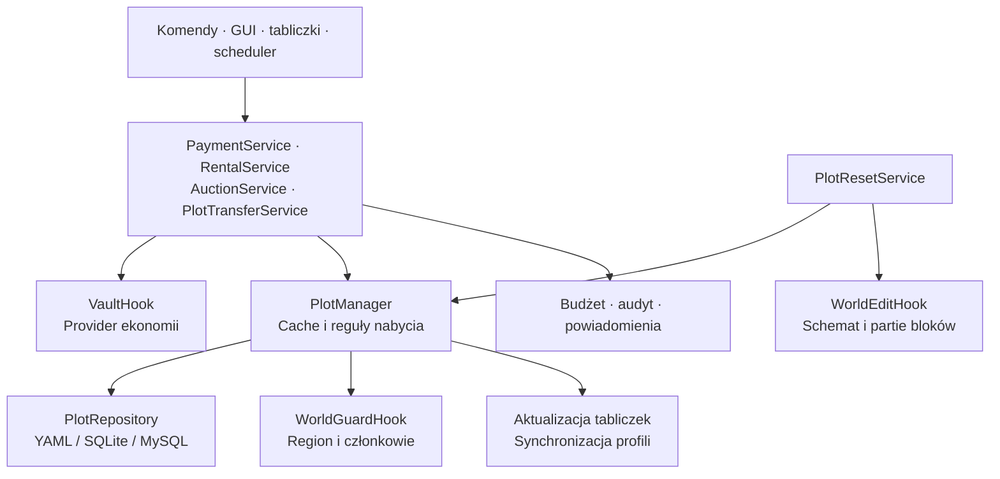

# Architektura i rozwój

[← README](../README.md) · [Komendy](commands.md) · [Przegląd kodu](review.md)

## Mapa projektu

Kod produkcyjny znajduje się w `src/main/java/pl/riftplots/`. Punkt wejścia to [`RiftPlotsPlugin`](../src/main/java/pl/riftplots/RiftPlotsPlugin.java).

```text
pl.riftplots
├── api/                 Zdarzenia Bukkit udostępniane innym pluginom
├── command/             Dispatcher, uzupełnianie i komendy graczy/administracji
├── config/              Odczyt konfiguracji i wiadomości
├── domain/              Działki, role, płatności, umowy, aukcje, dzielnice
├── gui/                 Menu ekwipunku i obsługa interakcji
├── integration/         Adaptery Vault, WorldEdit i WorldGuard
├── listener/            Ochrona terenu, tabliczki i sesje graczy
├── scheduler/           Podatki, kończenie najmu i rozliczanie aukcji
├── service/             Operacje biznesowe i zarządzanie stanem
├── storage/             Repozytoria YAML/SQL, backendy i migracja
└── util/                Tekst Adventure, czas i geometria
```



## Uruchomienie i przeładowanie

Plugin zapisuje brakujące konfiguracje, wczytuje ustawienia, sprawdza integracje i inicjalizuje backend. Następnie ładuje działki, tworzy usługi i rejestruje GUI, komendy oraz listenery. Na końcu wznawia działki ze stanem `RESETTING`, uruchamia scheduler i odświeża tabliczki.

`reloadPlugin()` ponownie wczytuje ustawienia do istniejących obiektów konfiguracji. Dzięki temu usługi, które zachowują referencje do konfiguracji i wiadomości, widzą aktualne wartości. Typy i dzielnice również są przeładowywane. Backend nie jest wymieniany w trakcie pracy.

## Stan i własność

`Plot` przechowuje granice 3D, właściciela, członków, parametry podatku, terminy oraz odwołania do najmu i aukcji. Dostępność zakupu sprawdza `isAvailableForPurchase()`: sam stan `AVAILABLE` nie wystarcza, jeśli istnieje oferta najmu, aktywny najem albo aukcja.

`PlotManager` utrzymuje cache. Przy zapisie aktualizuje region WorldGuard, profile po zmianie właściciela i powiązane tabliczki. Reguły nabycia uwzględniają zakaz sprzedaży typu/dzielnicy, dozwolone typy oraz limit własności w dzielnicy.

Statusy to `AVAILABLE`, `OWNED`, `PAYMENT_DUE`, `GRACE_PERIOD`, `RESETTING`, `DISABLED`. Scheduler przechodzi bezpośrednio z `OWNED` do `GRACE_PERIOD`; obsługuje też zapisany stan `PAYMENT_DUE`. Wynajem jest osobną umową i nie zmienia najemcy we właściciela.

## Zapis danych

Interfejsy repozytoriów obejmują działki, transakcje finansowe, profile graczy i tabliczki. SQLite i MySQL współdzielą implementacje SQL z odrębną składnią aktualizacji rekordów. `StorageBackend.getDatabaseManager()` udostępnia połączenia usługom SQL bez refleksji.

Najem, aukcje, budżet i audyt zapisują dane w swoich tabelach lub plikach YAML. `ServiceDataMigration` konwertuje te dane pomiędzy backendami, a `DataMigrationService` kopiuje również podstawowe repozytoria. Odczyt i zapis repozytoriów sygnalizują błędy zamiast zwracać pozorny sukces. `YamlDataFile` odmawia odczytu uszkodzonego YAML jako pustej bazy.

Większość operacji zapisu jest synchroniczna. `ConcurrentHashMap` i blokady w usługach nie czynią API świata Bukkit bezpiecznym do używania z dowolnego wątku. Operacje pluginu wykonuj na wątku serwera. Cache jednego procesu nie jest rozproszonym cache'em sieci serwerów.

## Schematy i reset

`PlotSnapshotService` zapisuje schemat przez plik tymczasowy, a następnie zastępuje poprzednią wersję. `WorldEditHook` kopiuje stan bloków bez encji.

Reset ma trzy etapy: zatwierdzenie i zapis `RESETTING`, odczyt schematu poza wątkiem serwera oraz wklejanie bloków partiami na wątku serwera. Nowa sesja WorldEdit jest zamykana po każdej porcji. Przed wklejaniem sprawdzane są wymiary schematu, a punkty docelowe wynikają z granic działki. Awaria prowadzi do `DISABLED`; stan `RESETTING` zapisany przed zatrzymaniem serwera jest odtwarzany podczas uruchamiania.

## Zdarzenia API

Klasy znajdują się w [`api/`](../src/main/java/pl/riftplots/api).

| Zdarzenie | Moment wywołania | Możliwości |
| :--- | :--- | :--- |
| `PlotBuyEvent` | Przed pobraniem pieniędzy za bezpośredni zakup przez `PaymentService` | Anulowanie, zmiana ceny. |
| `PlotTaxPayEvent` | Przed opłaceniem podatku | Anulowanie, zmiana kwoty. |
| `PlotExpireEvent` | Przed obsługą utraty działki za zaległości | Anulowanie wygaśnięcia. |
| `PlotResetStartEvent` | Przed odebraniem własności w resecie | Anulowanie resetu. |
| `PlotStateChangeEvent` | Podczas kończenia resetu | Zmiana stanu docelowego; anulowanie pozostawia działkę wyłączoną. |
| `PlotResetCompleteEvent` | Po zapisaniu wyniku resetu | Informacja o powodzeniu; nie jest anulowalne. |

`PlotStateChangeEvent` nie jest obecnie emitowane przy każdej zmianie statusu. Zakup w aukcji i transfer nie emitują `PlotBuyEvent`. Nie należy budować globalnej historii zmian wyłącznie na tych zdarzeniach. Ceny i kwoty zmodyfikowane w zdarzeniach płatności muszą być nieujemne i różne od `null`.

## Budowanie i testy

Wymagane jest JDK 25. Wrapper używa Gradle wskazanego w [`gradle-wrapper.properties`](../gradle/wrapper/gradle-wrapper.properties).

```powershell
.\gradlew.bat test
.\gradlew.bat build
```

Na Linux/macOS użyj `./gradlew`. Zadanie `build` uruchamia testy i buduje Shadow JAR: `build/libs/riftPlots-1.0.0.jar`. Gradle pobiera zależności z repozytoriów zapisanych w `build.gradle.kts`. Paper API jest wskazane jako `26.3.build.+`, więc wynik rozwiązywania zależności może zmienić się między pobraniami.

SQLite używa natywnego JNI. Jego klasy zachowują oryginalny pakiet `org.sqlite`; zmiana nazwy tego pakietu uniemożliwia bibliotece natywnej znalezienie `org.sqlite.core.NativeDB`. HikariCP i MySQL są relokowane. Pliki usług JDBC są scalane w Shadow JAR.

Test `ShadedSqliteTest` uruchamia osobną JVM z gotowym JAR-em, bez zależności SQLite z classpathu Gradle. Wykonuje rzeczywiste połączenie SQLite i zapytanie, co wykrywa błędy pakowania niewidoczne w samych testach repozytoriów.

| Zestaw testów | Zakres |
| :--- | :--- |
| `PlotBoundsTest`, `TaxCalculatorTest`, `DistrictAndTypeTest` | Geometria, podatki i dzielnice. |
| `RentalAndAuctionTest`, `PlotStateMachineTest` | Podstawy modeli umów, ofert, aukcji i statusów. |
| `YamlStorageTest`, `SqliteStorageTest` | Rzeczywisty odczyt i zapis backendów. |
| `MarketServiceTest` | Aukcje, kup teraz, nieudane wypłaty, odrzucenie ofert i odnowienie najmu. |
| `ProtectionRegressionTest` | Granice GUI, przeciąganie przedmiotów, własność, reset, schematy i teleportacja. |
| `StorageMigrationTest` | Przejście SQLite → YAML → SQLite, profile, usługi, budżet, audyt oraz błędy magazynu. |
| `ShadedSqliteTest` | Sterownik SQLite w gotowym artefakcie. |

HTML z wynikami: `build/reports/tests/test/index.html`. Testy usług używają atrap granic Bukkit/Vault; nie uruchamiają serwera Minecraft. Ręczne scenariusze integracyjne opisuje [raport przeglądu](review.md#zakres-weryfikacji).

Repozytorium nie zawiera pliku `LICENSE`. Wybór zasad udostępniania kodu i grafik pozostaje po stronie autora.
