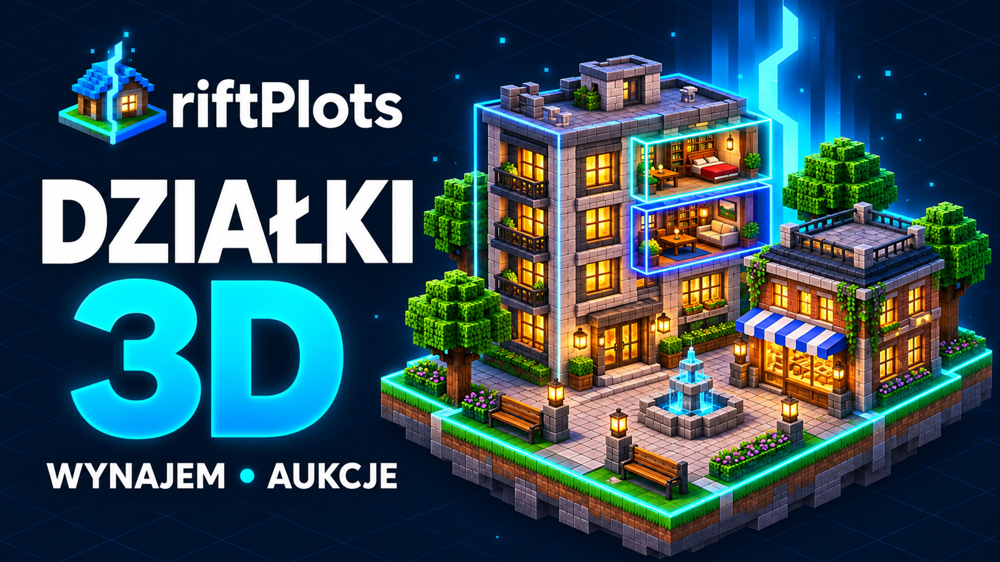

# Miniatura YouTube — riftPlots

Miniatura przygotowana 10 listopada 2026 r. w stylu banera i logo projektu: granatowe tło, siatka izometryczna, miasto voxelowe, turkusowe granice lokali i ciepłe światło okien.



## Pliki

| Plik | Wymiary | Rozmiar | Zastosowanie |
| :--- | :--- | :--- | :--- |
| [riftplots-thumbnail-4k.jpg](riftplots-thumbnail-4k.jpg) | 3840 × 2160, 16:9 | 1 627 838 B, około 1,63 MB | Gotowy plik do wgrania na YouTube; JPEG jakości 95. |
| [riftplots-thumbnail-4k.png](riftplots-thumbnail-4k.png) | 3840 × 2160, 16:9 | 12 728 142 B, około 12,73 MB | Bezstratny zapis eksportu 4K. |
| [riftplots-thumbnail-original.png](riftplots-thumbnail-original.png) | 1672 × 941 | 2 217 187 B, około 2,22 MB | Niezmieniony oryginał generacji. |

Generator zwrócił oryginał 1672 × 941. Eksport 3840 × 2160 powstał przez skalowanie z interpolacją HighQualityBicubic i minimalne wyśrodkowane dopasowanie proporcji (wysokość obszaru źródłowego 940,5 px). Wymiary pliku 4K są wymiarami powiększonego eksportu. Oryginał pozostaje dostępny w pełnej jakości zwróconej przez generator.

[Pomoc YouTube](https://support.google.com/youtube/answer/72431?hl=en) zaleca obecnie miniaturę filmu 3840 × 2160 i proporcje 16:9. Podaje limit 2 MB przy przesyłaniu z urządzeń mobilnych oraz 50 MB z komputera. Przygotowany JPG mieści się również w limicie 2 MB. Wymagania sprawdzono 10 listopada 2026 r.

## Wykonanie i referencje

Obraz wygenerowano wbudowanym narzędziem `image_gen`, z umiejętnością `imagegen`. Mechaniczny eksport wymiarów i kodowanie JPG/PNG wykonano lokalnie przez System.Drawing. Grafika jest ilustracją koncepcyjną, a nie zrzutem ekranu z Minecrafta.

Referencje:

- [Baner GitHub](../riftplots-banner.png) — paleta, wordmark i styl miasta.
- [Logo](../riftplots-logo.png) — dom z niebieskim dachem oraz turkusową szczeliną.
- [Ilustracja Wiki](../../wiki/assets/city-guide.png) — oddzielne lokale na piętrach i granice 3D.

Nie zmieniono oryginalnych grafik README ani Wiki. Scenariusz nagrania: [prezentacja.md](../../../prezentacja.md).

## Prompt końcowy

```text
Use case: ads-marketing.
Asset type: final high-resolution YouTube video thumbnail for the Minecraft city property plugin riftPlots.
Primary request: create a polished new 16:9 thumbnail adaptation of the supplied GitHub artwork, preserving its strong visual identity. Render at exactly 3840 x 2160 pixels, full-quality 4K landscape, opaque background.
Input images: Image 1 is the GitHub banner: reference for the midnight navy architectural grid, cyan/electric-blue rift lighting, beautiful voxel city style and exact riftPlots wordmark identity. Image 2 is the existing transparent house emblem: preserve the recognizable blue-roof house with a cyan rift as a small brand emblem. Image 3 is the city guide illustration: reference for the apartment building, warm interiors and separately outlined three-dimensional property volumes. These are style and identity references; create a fresh thumbnail composition, do not stretch or place the original wide banner inside a frame.
Scene/backdrop: deep midnight navy with a faint architectural/isometric grid and restrained cyan luminous particles. A beautiful premium isometric voxel city diorama on the right, featuring one dominant elegant stone-and-brick apartment townhouse, a smaller shop with a blue-white awning, a few block trees, warm golden lit windows, a small plaza and a floating grass-and-stone foundation. Highlight two separate apartment volumes on different floors of the dominant building with crisp luminous cyan rectangular 3D boundary outlines. A restrained angular electric-blue vertical rift behind the roofs echoes the original banner. Avoid clutter; this needs one immediately legible subject at small thumbnail size.
Style/medium: match the supplied premium voxel 3D editorial illustration, crisp constructed blocks, rich clean materials, cinematic warm/cool contrast, exceptionally finished original game-plugin artwork.
Composition/framing: edge-to-edge 16:9 design with no letterboxing. Left approximately 42 percent is reserved for high-impact typography on uncluttered dark background; the city occupies the right approximately 58 percent, extending toward the center with clear separation from the lettering. Keep all lettering and the emblem fully inside generous safe margins, no clipped characters. Leave the extreme lower-right corner visually quiet for a video-duration overlay. No screenshots or GUI are needed.
Brand: near upper left a small recognizable house/rift emblem, with the wordmark "riftPlots" in clean bold white sans-serif matching Image 1. Correct exact capitalization: lowercase r, uppercase P.
Headline: very large, bold, clean and perfectly readable Polish text "DZIAŁKI" and "3D" arranged as a strong two-line headline on the left. "DZIAŁKI" in white, "3D" in bright cyan/electric blue with tasteful depth and subtle glow. Preserve the Polish uppercase Ł exactly: D Z I A Ł K I.
Supporting copy: one short clean line beneath the headline, "WYNAJEM • AUKCJE", in smaller bold white/cyan type, readable but clearly subordinate.
Text (verbatim, no additional copy): "riftPlots", "DZIAŁKI", "3D", "WYNAJEM • AUKCJE".
Palette: midnight navy, cyan #00c6ff, electric blue #0072ff, white type, warm amber window light and restrained green foliage, consistent with the supplied GitHub assets.
Constraints: exact 3840x2160 canvas and 16:9; only the specified text; precise spelling; professional typography; no watermark, no YouTube play icon, no official Minecraft logo, no people/faces, no arrows or clickbait stickers, no unrelated badges, no fake interface, no extra border around the entire canvas. Keep the artwork cohesive, sharp and attractive as a real finished YouTube thumbnail.
```

