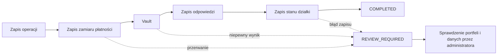

# Nowości P1–P2

[← Strona główna](Home.md) · [Komendy gracza](Komendy-gracza.md) · [Stan funkcji](Stan-funkcji.md)

Wdrożenie z 10 listopada 2026 r. obejmuje punkty 1–12 planu rozwoju. Numer wersji pluginu pozostaje `1.0.0`; zmiany wymagają zbudowania nowego JAR-a z tego repozytorium.

## Rozliczenia po awarii

Zakup, podatek, transfer, najem, odnowienie, licytacja, rozliczenie aukcji i zwrot mają ID operacji. Dziennik zapisuje zamiar wywołania Vault przed wywołaniem providera, a następnie jego odpowiedź. Niedokończona operacja po restarcie otrzymuje `REVIEW_REQUIRED`. Plugin zachowuje dowody i blokuje kolejne kolidujące rozliczenia nieruchomości.



Vault i baza pluginu pozostają osobnymi systemami. Niepewnej wypłaty nie wolno automatycznie powtarzać: provider mógł wykonać ją przed utratą połączenia. Samo ręczne uzgodnienie w pluginie nie zmienia salda ani własności.

```text
/plots admin transactions pending
/plots admin transactions inspect <id_operacji>
/plots admin transactions resolve <id_operacji> COMPLETED confirm <powód>
/plots admin transactions resolve <id_operacji> CANCELLED confirm <powód>
```

`COMPLETED` oznacza sprawdzone i naprawione zakończenie. `CANCELLED` oznacza sprawdzone anulowanie i pozwala na nową próbę tego zamiaru. Przed anulowaniem uzgodnij faktyczne pobrania i wypłaty z providerem ekonomii oraz stan właściciela, umowy, budżetu i historii. Dziennika nie należy usuwać jako sposobu „odblokowania” płatności.

Pliki dziennika znajdują się w `plugins/riftPlots/data/operations/`, niezależnie od wybranego backendu. Ich zachowanie jest częścią poprawnego backupu.

## Zwroty i zakończenie najmu

Wygaśnięcie lub zakończenie umowy odbiera prawa najemcy niezależnie od tego, czy ekonomia przyjęła zwrot kaucji. Zobowiązanie trafia do `data/refunds/`. Jednoznacznie odrzucone wypłaty są ponawiane z opóźnieniem od minuty do godziny; wynik niepewny wymaga interwencji.

```text
/plots admin transactions refunds
/plots admin transactions retry <id_zwrotu>
/plots admin transactions refund-resolve <id_zwrotu> PAID confirm <powód>
/plots admin transactions refund-resolve <id_zwrotu> PENDING confirm <powód>
/plots admin transactions refund-resolve <id_zwrotu> CANCELLED confirm <powód>
```

`PAID` potwierdza wykonaną wypłatę. `PENDING` przywraca możliwość próby wyłącznie po sprawdzeniu, że niepewna wypłata nie nastąpiła. `CANCELLED` zamyka zobowiązanie bez ponowienia. Polecenie uzgodnienia nie wypłaca pieniędzy. W historii gracza widać kwotę oraz stan jego zwrotów.

## Rynek, członkowie i granice

`/plots` otwiera rynek z zakładkami **Moje**, **Dostępne**, **Wynajem** i **Aukcje**. Strona mieści 45 nieruchomości. Dolny pasek zawiera zmianę strony, sortowanie po ID, cenie lub podatku oraz filtry dzielnicy i typu. Przyciski wskazują działki przez dane przedmiotu; zmiana wyświetlanej nazwy nie zmienia celu działania.

Potwierdzenie zakupu pokazuje cenę, podatek, okres i dodatkową prowizję kupującego. Zmiana ceny wymaga ponownego potwierdzenia. Przycisk granic zamyka okno, aby można było obejrzeć lokal w świecie.

```text
/plots border [id]
```

Obrys obejmuje wszystkie 12 krawędzi, również wysokość. Jest widoczny tylko dla danego gracza, nie zmienia bloków i znika po określonym czasie lub wylogowaniu. Limity określa sekcja `visualization`.

W panelu członków lewy przycisk otwiera edycję roli i dostępu, prawy usuwa członka. Wymagane są własność lub bypass oraz odpowiednio `riftplots.members.edit` i `riftplots.user.untrust`. Rola `MANAGER` daje pełny dostęp do uprawnień działki. Uprawnienia `TENANT` wynikają z umowy i nie są edytowane tym panelem.

Nowo dodani zwykli członkowie oraz najemcy mają `TELEPORT`. Dawne zapisane listy uprawnień pozostają bez zmian; właściciel może nadać brakujące prawo w edytorze. Dostęp najemcy wygasa według daty umowy także wtedy, gdy sprzątanie danych trafi na błąd zapisu.

## Najem kontrolowany przez gracza

```text
/plots rent <id> [okresy] [on|off]
/plots rent info <id>
/plots rent autorenew <id> on|off
/plots rent cancel <id>
/plots rent cancel <id> confirm
/plots rent offer <id> <czynsz> <HOUR|DAY|WEEK|MONTH> <kaucja> confirm
```

Auto-odnowienie jest domyślnie **wyłączone**. GUI pozwala wybrać je przed wynajmem. Wyłączenie nie skraca opłaconego czasu. Wcześniejsze rozwiązanie odbiera dostęp od razu, zwraca kaucję przez kolejkę i nie zwraca opłaconego czynszu; polecenie bez `confirm` pokazuje te zasady.

Samodzielne wystawianie lokalu wymaga jawnego nadania `riftplots.rent.offer` (domyślnie `false` w uprawnieniach). Serwis sprawdza własność, typ, dzielnicę i kolidujące operacje. Liczbę okresów ogranicza `rental.max-periods`.

## Aukcje i oferty transferu

```text
/plots auction history <id> [strona]
/plots auction buy <id> confirm
/plots admin auction cancel <id> confirm <powód>
```

Pełna historia przebić jest zapisywana, także po zakończeniu aukcji. Panel pokazuje minimalną ofertę, faktyczną dopłatę depozytu i osobny przycisk kup teraz. Przycisk zawiera ID aukcji, więc stare okno nie złoży oferty w nowej aukcji tego samego lokalu. Kup teraz jest dopuszczalne również wtedy, gdy zwykłe kolejne przebicie przekroczyłoby ten próg.

`auction.escrow-enabled: false` zachowuje pobranie przy finalizacji. Po włączeniu nowe aukcje rezerwują środki przy licytowaniu: obecny lider dopłaca tylko różnicę, a przebity gracz otrzymuje trwałe zobowiązanie zwrotu. Finalizacja nie pobiera ceny drugi raz. Anulowanie zwraca rezerwację przez kolejkę. Tryb jest zapisany w konkretnej aukcji, więc reload nie zmienia sposobu rozliczenia trwającej licytacji.

Oczekujące oferty transferu zachowują ID i datę ważności w `data/transfers.yml`. Restart nie przedłuża ważności oferty i nie pozwala powtórzyć zakończonego rozliczenia.

## Dziedziczenie i ręczne ceny

Nowe działki dziedziczą cenę, podatek, tryb, mnożnik, okres oraz procent zwrotu z definicji typu. Zapisana maska nadpisań odróżnia parametry ręczne. Przy cenie dziedziczonej zakup wynosi **domyślna cena typu × mnożnik cen dzielnicy**. `setprice` ustala końcową cenę ręczną. Reload wylicza wynik od podstaw.

Starsze rekordy zachowują wszystkie dotychczasowe parametry jako jawne nadpisania. Własność i aktywne umowy chronią warunki rozliczenia przed automatycznym przepisaniem stawek typu.

```text
/plots admin type apply-defaults <id>
/plots admin type apply-defaults <id> confirm
```

Pierwsze wywołanie pokazuje zmiany. Potwierdzenie usuwa indywidualne nadpisania; aktywny najem, aukcja i reset blokują tę operację. Ikona typu działa w rynku. Domyślne flagi WorldGuard typu są stosowane przy rejestracji i jawnym `apply-defaults`; obsługiwane są zarejestrowane flagi stanu z wartościami `allow`/`deny`.

## Historia, wiadomości i diagnostyka

```text
/plots history [id|all] [strona] [legacy]
/plots notifications [strona]
/plots admin audit <id> [strona]
/plots admin health
/plots admin health reset <id>
/plots admin reset <id> confirm
/plots admin restore <id> confirm
```

Historia domyślnie pokazuje wspólne operacje finansowe. `legacy` otwiera wcześniejsze rekordy repozytorium; zapytania SQL mają paginację. Historia nieruchomości jest prywatna dla właściciela i `riftplots.admin.history`, chyba że administrator włączy `privacy.public-history`. `all` u gracza pokazuje jego własne operacje.

Audyt zawiera operatora, zmienione ustawienia i członków, poprzedni oraz nowy stan i powiązanie z operacją finansową, gdy zmiana nastąpiła w jej zakresie.

Wiadomości są zapisywane przed wysłaniem. Potwierdzenie oznacza **wysłanie przez serwer**, a nie przeczytanie przez klienta. Przerwanie między wysłaniem a zapisem potwierdzenia może spowodować ponowne wysłanie. Domyślna retencja wysłanych wiadomości to 30 dni i 200 wpisów gracza; niewysłane nie są automatycznie obcinane.

`health` wyświetla aktywny backend i ustawienie pliku osobno, wersje integracji, schemat danych, wynik połączenia, problemy regionów i schematów oraz operacje wymagające uwagi. Niczego nie naprawia. Podgląd resetu sprawdza wczytanie i wymiary przed zmianą własności. Sam reset wymaga `confirm`; błędne przygotowanie zwalnia blokadę.

## Migracja, testy i backup

Schemat danych ma wersję **2**. Przed aktualizacją wykonaj kopię; starszego JAR-a nie należy uruchamiać na nowszym schemacie. Dziennik, zwroty, transfery i wiadomości pozostają w lokalnym katalogu danych także przy MySQL.

Migracja działa w uporządkowanej kolejce I/O. Na czas kopii wstrzymywane są zmiany i nowe logowania. Po sukcesie plugin zapisuje docelowy backend w `storage.yml` i utrzymuje blokadę do restartu. `/plots admin migrate resume confirm` rezygnuje z przełączenia i wraca do źródła; kopia docelowa staje się wtedy nieaktualna.

Podstawowa weryfikacja:

```powershell
.\gradlew.bat test build integrationProbeJar benchmarkPlots --console=plain
python scripts/wiki.py check
python -m unittest discover -s scripts/tests -v
```

Test MySQL jest osobny i wymaga `RIFTPLOTS_MYSQL_HOST`, `RIFTPLOTS_MYSQL_PORT`, `RIFTPLOTS_MYSQL_USER`, `RIFTPLOTS_MYSQL_PASSWORD`. Tworzy i usuwa wyłącznie własną losową bazę testową. CI uruchamia go na MySQL 8.4. Raport wydajności wyszukiwania 100/1 000/10 000 działek zapisuje się w `build/reports/benchmarks/spatial-index.json`; nie jest pomiarem TPS.

Izolowany serwer testowy, po przeczytaniu i zaakceptowaniu Minecraft EULA:

```powershell
powershell -NoProfile -ExecutionPolicy Bypass -File scripts/integration-server.ps1 -PrepareOnly
powershell -NoProfile -ExecutionPolicy Bypass -File scripts/integration-server.ps1 -AcceptEula
powershell -NoProfile -ExecutionPolicy Bypass -File scripts/integration-server.ps1
```

Skrypt pobiera przypięte zależności i sprawdza sumy. Uruchamia Paper 26.3 build 246, WorldEdit 7.4.6, WorldGuard 7.0.21 i Vault 1.7.3 wyłącznie na `127.0.0.1:25576`. Osobny plugin testowy zapewnia testową ekonomię, wykonuje scenariusz, zapisuje raport i zatrzymuje serwer. Pierwsza faza obejmuje zakup, piętra, najem, aukcję i rzeczywisty ekwipunek GUI, druga restart i reset, kolejne kontrolę zachowanego stanu. Używa zastępczych obiektów graczy; nie zastępuje próby z klientem Minecraft ani pełnego testu fizyki świata.

Backup zatrzymanego serwera:

```powershell
python scripts/backup.py create --server-dir C:/serwer --output C:/kopie/miasto.zip --server-stopped
python scripts/backup.py verify C:/kopie/miasto.zip
python scripts/backup.py restore C:/kopie/miasto.zip --target C:/serwer-odtworzony
```

Kopia obejmuje wszystkie lokalne pluginy, światy z `level.dat`, schematy, dane ekonomii i ustawienia serwera. Manifest sprawdza SHA-256 każdego pliku; odtwarzanie wymaga pustego lub nieistniejącego celu. Dla MySQL dodaj `--sql-dump <plik>` z dumpem wykonanym po zatrzymaniu zapisów. Zewnętrzna ekonomia również wymaga spójnego dumpa i osobnego importu SQL; skrypt przechowuje dumpy, ale nie importuje ich automatycznie.

Kod, skrypty i definicja CI są przygotowane lokalnie. Uruchomienie workflow na GitHub nastąpi po opublikowaniu zmian. Licencję projektu wybiera właściciel repozytorium.
