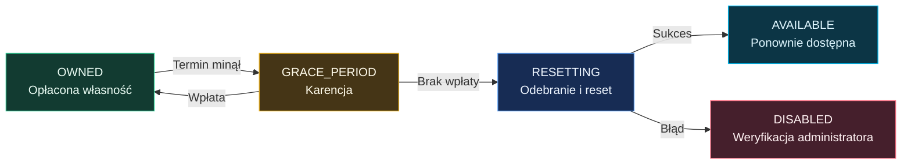

# Podatki i terminy

[← Strona główna](Home.md) · [Konfiguracja](Konfiguracja.md) · [Budżet miasta](Budzet-i-audyt.md)

## Zakup to początek rozliczeń

Cena zakupu jest jednorazowa. Własność może dodatkowo wymagać opłacania podatku cyklicznego. Każda działka przechowuje własną stawkę, tryb, długość okresu i termin płatności.

Domyślnie nowa działka ma podatek bazowy **1 500**, okres **7 dni** i karencję **6 godzin**. Administrator może ustawić inne wartości. Zawsze sprawdzaj konkretny lokal przez `/plots info <id>`.

## Cykl własności



Schemat pokazuje domyślną politykę automatycznego resetu. Jeżeli reset dla danej działki jest wyłączony, utrata własności może udostępnić lokal bez wklejania schematu. Stan `PAYMENT_DUE` także jest obsługiwany, lecz normalna ścieżka schedulera przechodzi bezpośrednio do karencji.

Terminy są sprawdzane domyślnie co 60 sekund. Karencja jest liczona od zapisanego terminu podatku, a nie od momentu uruchomienia serwera. Dłuższa przerwa techniczna nie zapewnia nowej pełnej karencji.

## Jak opłacić lokal?

```text
/plots pay rynek_1
/plots pay rynek_1 2
/plots extend rynek_1 2
```

Jednostką jest **okres działki**, nie zawsze dzień lub tydzień. Dwa okresy przy `setperiod 14` oznaczają 28 dni. `extend` wywołuje ten sam mechanizm co `pay`.

Jeśli termin jest w przyszłości, wpłata dodaje opłacone okresy do tego terminu. Przy zaległości punktem wyjścia staje się czas wpłaty. Uregulowanie karencji przywraca stan `OWNED`.

Domyślny limit wynosi cztery dodatkowe okresy z góry. Wolne miejsce w limicie wraca wraz z upływem opłaconego czasu; licznik nie jest dożywotnim limitem wpłat.

## Sześć modeli podatku

Oznaczenia: `B` — stawka bazowa, `A` — powierzchnia pozioma, `C` — liczba przecinanych chunków, `M` — mnożnik działki, `D` — mnożnik podatku dzielnicy albo `1` bez dzielnicy.

| Tryb | Wzór |
| :--- | :--- |
| `FIXED` | `B × D` |
| `CUSTOM` | `B × D`; aktualnie ten sam wzór co `FIXED`. |
| `PER_BLOCK` | `B × A × D` |
| `PER_CHUNK` | `B × C × D` |
| `MULTIPLIER` | `B × max(0.01, M) × D` |
| `SIZE_TIERS` | `B × współczynnik powierzchni × D` |

Powierzchnia wynosi `(maxX − minX + 1) × (maxZ − minZ + 1)`. Wysokość nie zwiększa podatku od bloku. Liczone są wszystkie chunki przecinające działkę, również częściowo. Wynik jest zaokrąglany do dwóch miejsc metodą `HALF_UP`.

| Powierzchnia w `SIZE_TIERS` | Mnożnik |
| :--- | ---: |
| Do 250 | 1.0 |
| 251–1 000 | 1.5 |
| 1 001–2 500 | 2.5 |
| 2 501–5 000 | 4.0 |
| Powyżej 5 000 | 6.0 |

### Przykłady

| Lokal | Obliczenie | Podatek za okres |
| :--- | :--- | ---: |
| Stały podatek w centrum | `3 000 × 1.25` | 3 750.00 |
| 10 × 10 bloków, stawka 2.50, centrum | `2.50 × 100 × 1.25` | 312.50 |
| Obszar X/Z `0..31`, cztery chunki, stawka 500 | `500 × 4` | 2 000.00 |
| 625 bloków, `SIZE_TIERS`, podstawa 100 | `100 × 1.5` | 150.00 |

Wyłączenie podatku w modelu powoduje brak naliczania i obsługi wygaśnięcia podatkowego. Sama stawka `0` daje podatek zerowy, ale nie jest tym samym co wyłączenie mechanizmu terminów.

## Zmiany administracyjne

```text
/plots admin settax rynek_1 3000
/plots admin settaxmode rynek_1 FIXED
/plots admin setperiod rynek_1 7
/plots admin setgrace rynek_1 6
```

`settax` ustawia podstawę; nie pomija mnożnika dzielnicy. `CUSTOM` również nie pomija tego mnożnika. Zmiana okresu nie jest poleceniem natychmiastowej wpłaty ani automatycznego przepisania wszystkich już zapisanych terminów.

Jeżeli podatek wydaje się nieprawidłowy, porównaj stawkę bazową, tryb, rzeczywiste wymiary i przypisaną dzielnicę w `/plots admin info <id>`.
