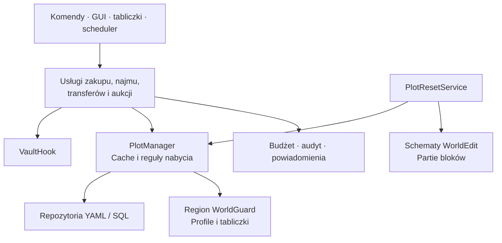

# Rozwój i testy

[← Strona główna](Home.md) · [API](API-i-integracje.md) · [Stan funkcji](Stan-funkcji.md)

## Środowisko

Kod projektu jest kompilowany toolchainem Javy 25. Używaj wrappera Gradle dostarczonego w katalogu projektu i zależności z `build.gradle.kts`.

```powershell
.\gradlew.bat test
.\gradlew.bat build
```

Na Linux/macOS odpowiednikiem jest `./gradlew`. Wynikowy plugin to `build/libs/riftPlots-1.0.0.jar`.

## Architektura



| Katalog | Rola |
| :--- | :--- |
| `api/` | Zdarzenia dla dodatków. |
| `command/`, `gui/`, `listener/` | Wejścia użytkownika i zdarzenia serwera. |
| `domain/` | Działki, role, płatności, umowy i aukcje. |
| `service/` | Operacje biznesowe. |
| `storage/` | Backend, repozytoria i migracja. |
| `integration/` | Granice Vault, WorldEdit i WorldGuard. |
| `config/`, `scheduler/`, `util/` | Ustawienia, obsługa terminów i narzędzia. |

## Co sprawdzają testy?

Stan sprawdzony 10 listopada 2026 r.: **102 testów Java zakończonych powodzeniem**, bez pominięć przy włączonym teście rzeczywistego MySQL. Osobno wykonano testy backupu i izolowanego Paper. [Pełna procedura P1–P2](Nowosci-P1-P2.md#migracja-testy-i-backup).

| Obszar | Weryfikacja |
| :--- | :--- |
| Domena | Granice, progi podatków, dzielnice, modele umów i statusów. |
| Repozytoria | Rzeczywisty odczyt i zapis YAML/SQLite. |
| Rynek | Aukcje, kup teraz, odmowy płatności, refundacja po nieudanej wypłacie i transfery. |
| Najem | Odczyt wygasłej umowy po restarcie i rozliczenie odnowienia. |
| Interfejs i ochrona | Kliknięcia dolnego ekwipunku, przeciąganie, zmiana właściciela, reset i teleportacja. |
| Migracja | SQLite → YAML → SQLite, profile i dane usług, historia budżetu i audytu. |
| Gotowy artefakt | Natywne połączenie SQLite z JAR-a w osobnym procesie Java. |

Raport HTML: `build/reports/tests/test/index.html`. Dla powtórzenia bez wyników cache:

```powershell
.\gradlew.bat test build --rerun-tasks --no-build-cache --console=plain
```

## Dlaczego testujemy JAR osobno?

Samo przejście testu repozytorium może korzystać ze sterownika na classpathie Gradle i ukryć błąd pakowania pluginu. `ShadedSqliteTest` uruchamia izolowaną JVM z gotowym artefaktem i wykonuje zapytanie SQLite.

Pakiet `org.sqlite` musi zachować oryginalną nazwę z powodu JNI. HikariCP i MySQL są relokowane, a deskryptory usług JDBC scalane przez Shadow.

## Próba integracyjna na serwerze

Testy usług używają atrap odpowiedzi Bukkit i Vault. Nie uruchamiają pełnej rozgrywki. Przed wdrożeniem sprawdź:

1. Dwa sąsiadujące lokale i osobny lokal na piętrze.
2. Zakup, role członków, podatki i teleportację.
3. Najem z kaucją, odnowieniem i zakończeniem.
4. Transfer oraz aukcję z brakiem środków przy rozliczeniu.
5. Reset ze schematem i restart w trakcie.
6. Docelowy MySQL, zapis, restart i utratę połączenia, jeśli używasz tego backendu.

API Paper jest przypięte do `26.3.build.246-stable`. Workflow GitHub Actions buduje JAR, uruchamia testy z MySQL 8.4 i sprawdza dokumentację oraz backup. Licencję wybiera właściciel. Wynik lokalnej próby nie oznacza wykonania workflow na GitHub.
