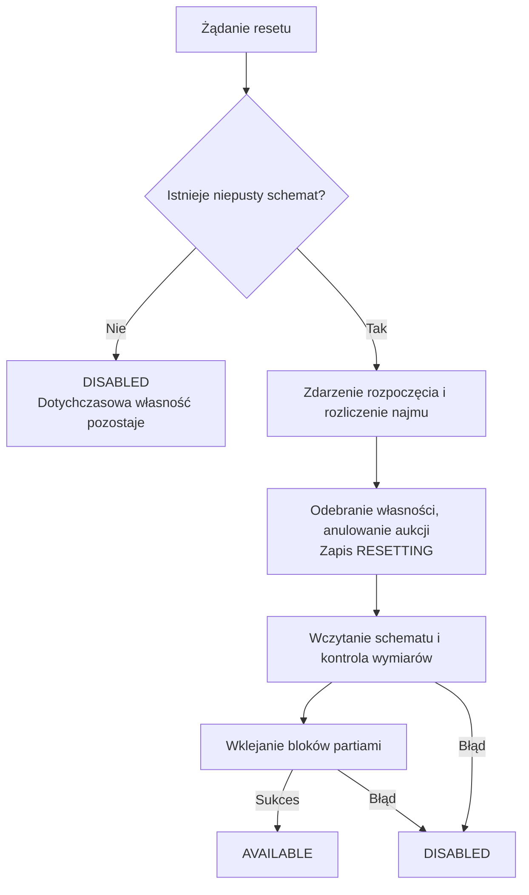

# Schematy i reset nieruchomości

[← Strona główna](Home.md) · [Ochrona](Ochrona-terenu.md) · [Kopie zapasowe](Migracja-i-kopie-zapasowe.md)

## Czym jest wzorzec?

Schemat w `plugins/riftPlots/schematics/<id>.schem` przechowuje pierwotny stan bloków nieruchomości i ich dane. Powstaje przy tworzeniu działki. Encje nie są kopiowane; reset nie służy do odtwarzania mobów, pojazdów czy wszystkich elementów świata.

Przygotuj wzorzec jako gotowy lokal dla następnego użytkownika. Zawartość pojemników i inne dane zapisane z blokami mogą być częścią wzorca — sprawdź efekt na testowym budynku.

## Trzy komendy, dwie różne operacje

| Komenda | Znaczenie |
| :--- | :--- |
| `/plots admin snapshot rynek_1` | Zapisuje aktualny stan jako nowy wzorzec. |
| `/plots admin reset rynek_1` | Usuwa własność i uruchamia odtworzenie wzorca. |
| `/plots admin restore rynek_1` | Wywołuje ten sam mechanizm resetu, również usuwając własność. |

> **`restore` nie zachowuje właściciela.** Jeśli chcesz tylko naprawić kilka bloków właściciela, nie traktuj tej komendy jako kosmetycznej naprawy.

Snapshot jest zapisywany przez plik tymczasowy, a następnie zastępuje poprzedni plik po sukcesie. To chroni wcześniejszy wzorzec przed zwykłą nieudaną próbą zapisu, ale nie zastępuje kopii zapasowej.

## Co uruchamia reset?

Reset może rozpocząć administrator. Przy domyślnej polityce uruchamia go także utrata działki po karencji albo potwierdzone porzucenie. Ustawienie automatycznego resetu jest przechowywane dla konkretnej działki; globalna zmiana nie przepisuje automatycznie wszystkich istniejących rekordów.

## Przebieg



Dodatek korzystający z API może anulować rozpoczęcie. Nieudany zwrot kaucji również może powstrzymać przejście do resetu. Po zaakceptowanym rozpoczęciu własność, współużytkownicy, punkt domowy i dane bieżącego użytkowania są czyszczone.

Odczyt schematu odbywa się poza wątkiem serwera. Wklejanie świata odbywa się na jego wątku w porcjach:

```yaml
reset:
  auto-reset-on-expire: true
  block-batch-size: 2500
  tick-delay: 1
```

Domyślnie jedna porcja obejmuje do 2 500 bloków, z odstępem jednego ticka. Jeden tick odpowiada nominalnie 50 ms przy 20 TPS, lecz obciążony serwer może wykonywać ticki wolniej. Wymiary schematu muszą pasować do granic działki.

## Restart w trakcie pracy

Stan `RESETTING` jest zapisany w backendzie. Po uruchomieniu plugin próbuje ponownie wykonać reset takich działek. Nie jest to wznowienie dokładnie od ostatniego bloku — schemat może zostać nałożony ponownie.

## Gdy reset się nie powiedzie

Sprawdź plik, jego rozmiar, wymiary, dostępność świata, zapis backendu i pierwszy wyjątek WorldEdit. Działka wyłączona po błędzie wklejania mogła już utracić właściciela. Działka wyłączona z powodu brakującego schematu zachowuje dotychczasową własność.

Przywróć prawidłowy schemat z kopii i ponów `restore`. Nie zapisuj nowego `snapshot` z uszkodzonego budynku tylko po to, aby usunąć komunikat — zastąpiłoby to poprawny wzorzec niewłaściwym stanem.
