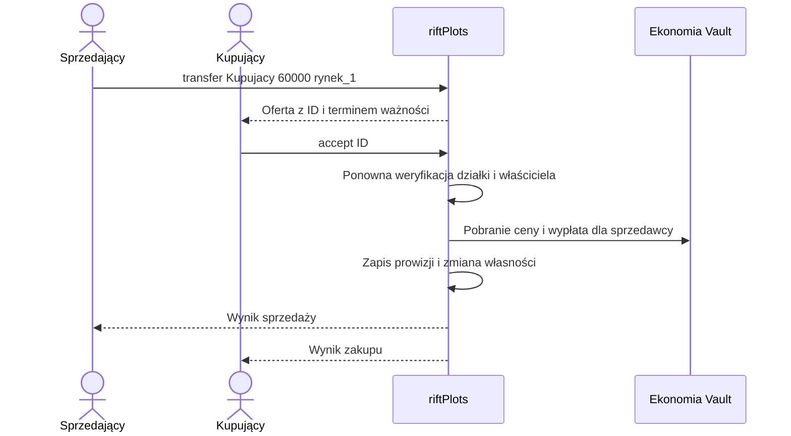

# Transfery i sprzedaż między graczami

[← Strona główna](Home.md) · [Aukcje](Aukcje.md) · [Budżet i audyt](Budzet-i-audyt.md)

## Kiedy użyć transferu?

Transfer służy do sprzedaży nieruchomości wskazanej osobie albo bezpłatnego przekazania własności. Wymaga oferty i akceptacji kupującego. Nie jest tym samym co administracyjne `setowner`.

## Warunki

Sprzedający musi być właścicielem. Lokal musi pozostawać w stanie `OWNED`, bez aktywnej aukcji i umowy najmu. Stany `PAYMENT_DUE` oraz `GRACE_PERIOD` blokują wystawienie. Typ i dzielnica muszą pozwalać na sprzedaż, a kupujący musi mieścić się w limicie własności dzielnicy.

Kupujący musi być online podczas tworzenia oferty. Cena może wynosić `0`, ale nie może być ujemna.

## Sprzedający wysyła ofertę

```text
/plots transfer Kupujacy 60000 rynek_1
```

Kupujący otrzymuje informację z identyfikatorem oferty. Domyślnie oferta jest ważna przez **300 sekund**. Nowa oferta dla tej samej działki usuwa poprzednią aktywną ofertę.

## Kupujący decyduje

```text
/plots accept <id_oferty>
/plots deny <id_oferty>
```

`accept` bez identyfikatora wybiera jedną z otrzymanych ofert. Przy kilku ofertach zawsze podawaj ID. `deny` może wykonać kupujący, by odrzucić ofertę, lub sprzedający, by ją anulować.



## Rozliczenie ceny

Przy domyślnej prowizji 5% i cenie 60 000:

| Odbiorca | Kwota |
| :--- | ---: |
| Sprzedający | 57 000 |
| Budżet miasta | 3 000 |
| Łączne obciążenie kupującego | 60 000 |

Jeśli wypłata dla sprzedawcy się nie powiedzie, serwis próbuje zwrócić cenę kupującemu i nie przekazuje własności. Awaria bazy lub procesu pomiędzy etapami nadal wymaga weryfikacji — Vault i zapis pluginu nie są jedną atomową transakcją.

Po udanym transferze stare oferty dla działki są usuwane. Członkowie i punkt domowy poprzedniej własności są czyszczone. Nowy właściciel powinien ustawić własny dom i ponownie zaprosić współużytkowników.

## Co z terminem podatku?

Transfer nie jest komendą opłacenia podatku. Implementacja zachowuje zapisany termin działki. Kupujący powinien sprawdzić go od razu przez `/plots info <id>` i nie zakładać, że cena sprzedaży obejmuje nowy pełny okres.

Oferty transferu są przechowywane w pamięci. Restart usuwa oczekujące oferty; sprzedający musi wtedy wystawić nową. Zapisana historia udanych transakcji pozostaje w backendzie.
