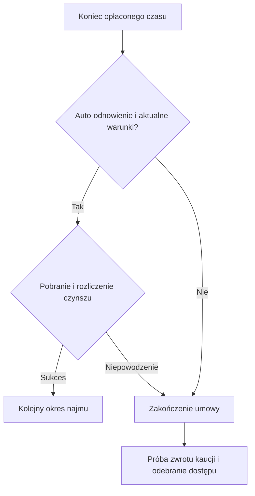

# Wynajem lokali

[← Strona główna](Home.md) · [Podatki](Podatki.md) · [Komendy administracji](Komendy-administratora.md)

## Własność pozostaje oddzielna

Umowa najmu pozwala korzystać z przygotowanej nieruchomości bez zakupu jej własności. Właścicielem może być gracz; lokal bez właściciela traktowany jest jako miejski. Czynsz trafia odpowiednio do właściciela albo do budżetu miasta.

Nowy najemca otrzymuje rolę `TENANT` i prawa `BUILD`, `DESTROY`, `CONTAINERS`, `DOORS`, `INTERACT`, `TELEPORT`. Nie uzyskuje przez to możliwości sprzedaży, porzucenia ani zarządzania własnością.

## Wystawienie lokalu

Administrator wpisuje:

```text
/plots admin rent offer apartament_4 250 DAY 500
```

| Argument | Znaczenie |
| :--- | :--- |
| `apartament_4` | Identyfikator nieruchomości. |
| `250` | Czynsz za jeden okres najmu. |
| `DAY` | Jednostka okresu. |
| `500` | Kaucja; można pominąć, wtedy wynosi zero. |

Kwoty muszą być nieujemne. Lokal musi być w odpowiednim stanie, bez aktywnego najmu i aukcji. Typ i dzielnica muszą dopuszczać wynajem. Zwykła sprzedaż działki z ofertą najmu jest blokowana.

Właściciel z jawnie nadanym `riftplots.rent.offer` może użyć `/plots rent offer apartament_4 250 DAY 500 confirm`. Uprawnienie ma domyślnie wartość `false`; nie wymaga osobnego przełącznika konfiguracji.

| Jednostka | Długość |
| :--- | :--- |
| `HOUR` | 1 godzina |
| `DAY` | 24 godziny |
| `WEEK` | 7 dni |
| `MONTH` | 30 dni, nie miesiąc kalendarzowy |

## Podpisanie umowy przez gracza

```text
/plots rent apartament_4 7
```

Liczba `7` oznacza siedem okresów jednostki ustawionej w ofercie. Jeśli jej nie podasz, wynajmujesz na jeden okres.

Pierwsza należność:

```text
czynsz × liczba okresów + kaucja
250 × 7 + 500 = 2 250
```

Kaucja nie jest czynszem właściciela. Jest przechowywana jako zobowiązanie umowy i zwracana przy jej zakończeniu, gdy operacja ekonomii zakończy się powodzeniem.

## Automatyczne odnowienie

Auto-odnowienie jest domyślnie wyłączone. Włącz je świadomie przez `/plots rent autorenew <id> on`, argument `on` przy wynajmie lub przełącznik GUI. Po końcu opłaconego czasu scheduler próbuje pobrać czynsz za **jeden kolejny okres**. Nie pobiera ponownie kaucji i nie odnawia automatycznie na pierwotne siedem okresów.



Odnowienie wymaga zgodności bieżącego właściciela i stanu nieruchomości z umową. Nieudana płatność nie powinna dopisywać bezpłatnego okresu.

## Zakończenie

Administrator może zakończyć najem i wyłączyć ofertę:

```text
/plots admin rent cancel apartament_4
```

Zakończenie umowy odbiera prawa najemcy i czyści powiązanie z lokalem niezależnie od wyniku wypłaty kaucji. Sam koniec najmu nie wkleja schematu. Najemca może użyć `/plots rent cancel apartament_4`, przeczytać zasady i dodać `confirm`; wcześniejsze zakończenie nie zwraca opłaconego czynszu.

Jeżeli provider odrzuci zwrot kaucji, umowa kończy się i dostęp wygasa, a zobowiązanie zostaje w trwałej kolejce. Niepewna wypłata wymaga uzgodnienia. [Zwroty i nowe komendy](Nowosci-P1-P2.md#zwroty-i-zakończenie-najmu).

## Aktualne granice funkcji

- Właściciel może wystawić lokal przez `rent offer`, jeśli administracja nada mu uprawnienie.
- Najemca ma `rent info`, `rent autorenew` i `rent cancel <id> confirm`; wcześniejsze zakończenie nie zwraca opłaconego czynszu.
- `untrust` i usunięcie członka w GUI nie służą do odebrania dostępu aktywnemu najemcy.
- Umowa najmu i podatek właściciela to oddzielne mechanizmy. Najem nie zamienia czynszu w podatek i nie przejmuje zobowiązań właściciela.
